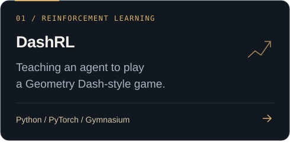
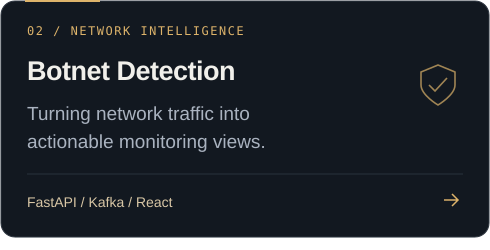
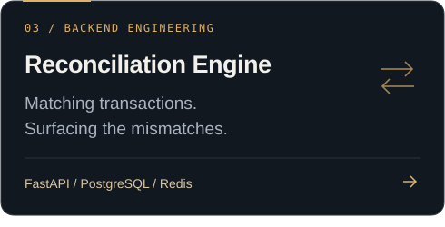
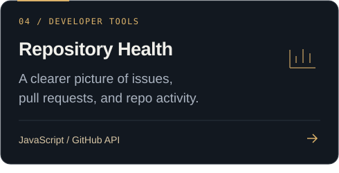

  

  <a href="https://www.linkedin.com/in/vaibhav-patole-7016b5376/"><strong>LinkedIn ↗</strong></a>
  &nbsp;&nbsp; / &nbsp;&nbsp;
  <a href="https://github.com/Vaibhav0PS?tab=repositories"><strong>Explore my work ↗</strong></a>

 

### A little about me

I build across **machine learning, backend systems, and the web** — from game-playing agents to tools for understanding network traffic. I enjoy connecting the pieces: the model, the API, and the interface.

 

### Selected work
A few projects from my corner of GitHub. Click a card to explore.

  
  
  
  

 

### My toolkit

**Languages** &nbsp; <code>Python</code> <code>JavaScript</code> <code>TypeScript</code> <code>C++</code> <code>C</code> <code>Go</code>

**Building with** &nbsp; <code>React</code> <code>FastAPI</code> <code>PyTorch</code>

**Data & tooling** &nbsp; <code>PostgreSQL</code> <code>Redis</code> <code>Kafka</code> <code>Git</code>

 

<strong>A little GitHub activity</strong>

 

  

 

---

  Have something interesting in mind? 
  <a href="https://www.linkedin.com/in/vaibhav-patole-7016b5376/"><strong>Let's connect ↗</strong></a>

